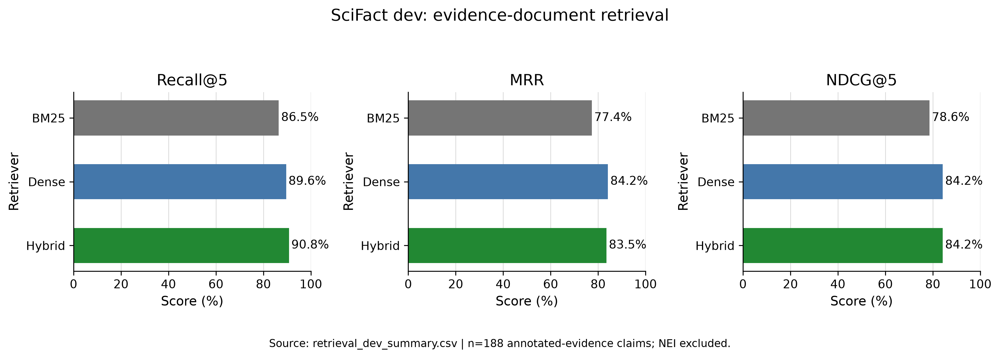
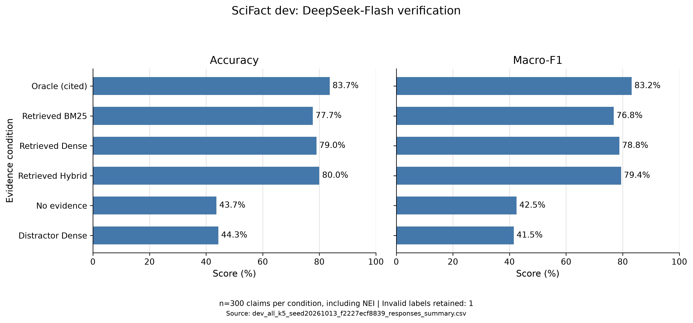
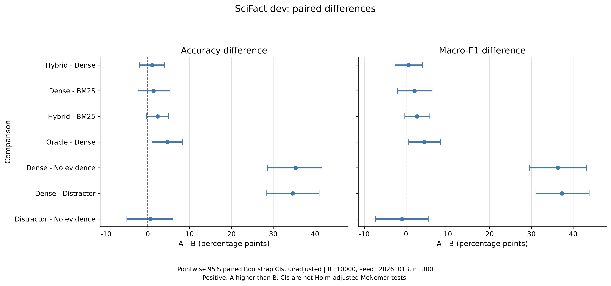

# 科学事实核验中的证据检索与大模型判断

基于 SciFact，比较 BM25、稠密检索和混合检索，并研究不同证据输入如何影响大模型的事实核验判断。

本项目是一个本科实证研究项目，重点在于检索评测、对照实验、配对统计与错误分析，不声称提出新的检索算法。

## 主要发现

- 稠密检索和混合检索在部分检索指标上优于 BM25，但混合检索没有在所有指标上优于稠密检索。
- 在本次实验设置下，提供检索摘要显著提高了大模型与 SciFact 标签的一致率。
- 三种检索条件下的大模型判断成绩存在数值差异，但尚未得到明确的统计差异支持。
- 未命中标注文档不一定意味着没有有效证据；命中标注文档也不保证模型判断与标准标签一致。
- 部分标签不一致涉及模型已有知识或证据覆盖范围，不能全部归为幻觉。

## 1. 研究问题

1. BM25、稠密检索与混合检索的证据文档检索效果有何差异？
2. 参考论文摘要、检索摘要、无证据和干扰候选摘要，如何影响同一个大模型的判断？
3. 检索遗漏与最终判断错误之间有什么关系？
4. 如何结合统计比较和人工核对，解释检索指标与核验结果之间的不一致？

## 2. 数据与实验划分

使用 SciFact 原始数据：

- 语料库：5,183 篇论文，包含标题和按句子划分的摘要。
- train：809 条论断，其中 SUPPORT 332 条、CONTRADICT 173 条、NOT_ENOUGH_INFO 304 条。
- dev：300 条论断，其中 SUPPORT 124 条、CONTRADICT 64 条、NOT_ENOUGH_INFO 112 条。
- test：300 条论断，公开文件不提供评测所需的标签。

本项目将 train 用于实现开发、权重探索和先导实验，将 dev 作为锁定设置后的本地留出评测集。这里的 dev 不是官方 test；本项目没有报告官方 test 成绩。

数据检查确认：标注证据文档均存在于语料库中，证据句索引没有发现越界或无效引用。

### 两类评测使用不同的样本范围

证据检索评测只使用有标注证据的论断：

- train：505 条。
- dev：188 条。

NOT_ENOUGH_INFO（简称 NEI）没有支持或反驳的标注证据，因此不参与这些检索指标的计算。

大模型三分类评测包含全部 dev 论断，包括 112 条 NEI，共 300 条。

## 3. 检索方法

### BM25

使用论文标题和完整摘要构建文档文本，进行英文分词和小写处理。

参数：

- k1 = 1.5
- b = 0.75

BM25 根据词项匹配、词频和文档长度等信息计算相关性。

### 稠密检索

使用预训练模型 BAAI/bge-small-en-v1.5，将论断与文档编码为向量。

设置：

- 文档文本：标题与完整摘要拼接。
- 查询指令：`Represent this sentence for searching relevant passages: `
- 向量维度：384。
- 最大编码长度：512 tokens，超长文本在嵌入编码时被截断。
- 向量归一化后使用点积计算余弦相似度。
- 在全部 5,183 篇文档上进行精确相似度排序。
- 本项目未在 SciFact 上微调该模型。
- 本地编码使用 CPU，并缓存语料库向量。

### 混合检索

使用加权 Reciprocal Rank Fusion（RRF）融合两种方法的排名：

```text
RRF(d)
= BM25权重 / (60 + BM25排名)
+ Dense权重 / (60 + Dense排名)
```

排名从 1 开始。

正式比较中的 Hybrid 是固定的等权基线：

- BM25权重 = 1
- Dense权重 = 1
- RRF平滑常数 = 60

train 上另外探索了 BM25 权重：

```text
0、0.25、0.5、0.75、1
```

Dense 权重固定为 1，以 Recall@5 为主要选择指标，NDCG@5 和 MRR 为后续排序指标。

最终选中的 BM25 权重为 0，即退化为纯 Dense。因此，本项目没有把等权 Hybrid 描述为“训练集选出的最优配置”，而是保留它作为预先设置的比较基线。

查看 dev 结果后，没有继续修改融合权重。

## 4. 大模型证据条件

所有条件使用同一个 DeepSeek 模型和相同的判断提示，区别仅在于提供的摘要内容。

### oracle_cited

提供数据集中 `cited_doc_ids` 对应的参考论文完整摘要。

包括 NEI 论断的参考文档，避免是否提供文档直接泄露标签。

它不是只提供金标准证据句的 Oracle，也不是严格的理论性能上限。

### retrieved_bm25

提供 BM25 排名前 5 的论文摘要。

### retrieved_dense

提供 Dense 排名前 5 的论文摘要。

### retrieved_hybrid

提供等权 RRF 排名前 5 的论文摘要。

### no_evidence

只提供论断，不提供论文摘要。

### distractor_dense

从 Dense 排名中排除该论断的参考文档和标注证据文档，再取前 5 篇摘要。

这是利用标注信息构建的实验控制条件，不是可直接部署的检索方法。

这些文档是“干扰候选”，不保证每篇都无关、错误或具有误导性。它们也可能包含未被标注的有效证据。

dev 中有 66 条论断的 Dense 与干扰条件输入完全相同，因此两种条件并不是对每条论断都进行了不同的证据干预。

## 5. 大模型设置与输出

- 请求模型：deepseek-flash。
- 思考模式：disabled。
- temperature：0。
- max_tokens：1024。
- 输出格式：JSON。
- 提示版本：evidence_assisted_v1。
- 先导实验：train 每类抽取 10 条，共 30 条、180 个逻辑输入。
- 正式评测：dev 全部 300 条、每条 6 种条件，共 1,800 个逻辑输入。

模型输出：

- label：SUPPORT、CONTRADICT 或 NOT_ENOUGH_INFO。
- decision_basis：provided_evidence、model_knowledge 或 insufficient_information。
- citations：文档ID与从0开始的摘要句子ID。
- explanation：简短解释。

### 判断协议

所有条件均允许模型在提供的摘要缺失或不足时使用已有科学知识。

因此，本项目研究的是“证据辅助判断”，不是严格的“仅根据给定证据判断”。

程序将标准标签、金标准证据和条件标识保留在本地评测元数据中，不将这些字段直接作为消息内容发送给模型。

模型自报的 `decision_basis` 只能用于行为描述，不能证明其实际内部推理过程。

### 调用与异常处理

- 保存原始响应、配置指纹、解析结果、检查结果和Token统计。
- 支持分批执行、网络错误重试和断点续跑。
- 对配置和消息完全相同的输入复用已保存回答。
- 1,800 个逻辑回答中，1,726 个来自实际API回答，74个为复用。
- 3次API错误事件最终恢复成功。
- 1条Dense回答因输出截断而无法得到有效标签，保留在分母中并计为错误，没有事后修复或删除。

完全相同输入的复用也是实验设置的一部分，本实验不用于估计重复调用时的生成波动。

## 6. 评价方法

### 检索指标

- Recall@K：前K篇找回的标注证据文档，占该论断全部标注证据文档的比例。
- Hit@K：前K篇是否至少命中一篇标注证据文档。
- MRR：第一篇标注证据文档排名的倒数，再对论断取平均。
- NDCG@K：以标注证据文档为二元相关性，衡量前K篇的检索质量及排名位置。

Recall@K 不等于 Hit@K：有些论断对应多篇证据文档。

### 判断指标

- Accuracy：预测标签与标准标签一致的比例。
- Macro-F1：分别计算三个标准类别的F1，再取平均。

无效标签保留在评测中，计为错误。Macro-F1仍只对三个标准类别求平均。

这些指标衡量与数据集标注的一致性，不直接等同于对科学真实性的完整判断。

### 配对统计

以 claim 为配对单位：

- 10,000次配对 Bootstrap。
- 95%百分位置信区间。
- 随机种子：20261013。
- McNemar双侧精确检验。

Bootstrap 每次对同一组 claim 同时重采样各方法，保持配对关系。Macro-F1在每次重采样后重新计算。

大模型六种条件共有15组两两比较，Accuracy的McNemar p值使用Holm方法校正。

Bootstrap区间为逐项区间，未进行多重比较校正。McNemar检验比较正确率，不是Macro-F1检验。

检索部分的McNemar检验作用于Hit@K，报告的是未校正的探索性p值。

## 7. dev检索结果

- BM25：Recall@5 = 0.8648，Hit@5 = 0.8830，MRR = 0.7738，NDCG@5 = 0.7861。
- Dense：Recall@5 = 0.8957，Hit@5 = 0.9096，MRR = 0.8416，NDCG@5 = 0.8422。
- Hybrid：Recall@5 = 0.9078，Hit@5 = 0.9202，MRR = 0.8354，NDCG@5 = 0.8420。



> 注：BM25是基于词项匹配的检索方法；Dense表示稠密向量检索；Hybrid表示等权RRF混合检索。`@5`表示只评价排名前5篇文档。Recall@5衡量找回标注证据文档的比例；MRR（Mean Reciprocal Rank，平均倒数排名）关注第一篇标注证据文档的位置；NDCG@5（Normalized Discounted Cumulative Gain，归一化折损累计增益）同时考虑证据是否命中及其排名。
>
> `dev`表示本项目使用的留出评测集；`n=188`表示参与检索评测的论断数量。NEI（Not Enough Information，证据不足）没有支持或反驳的标注证据，因此不参与这部分检索指标计算。横轴将0～1的指标乘以100展示；MRR和NDCG不是正确率。柱子的高低只反映数值大小，统计差异需结合后文检验结果判断。

在逐项Bootstrap区间下：

- Dense相对BM25的MRR和NDCG@5差值区间排除0，Recall@5差值区间包含0。
- Hybrid相对BM25的MRR、Recall@5和NDCG@5差值区间排除0。
- Hybrid与Dense的这三个指标差值区间均包含0。

三组Hit@5精确McNemar比较均未达到0.05显著性水平。

因此，不能仅凭Hybrid的Recall@5数值最高，就认定它整体上优于Dense。

## 8. dev大模型判断结果

各条件均评测300条论断：

- oracle_cited：251/300，Accuracy = 0.8367，Macro-F1 = 0.8315。
- retrieved_bm25：233/300，Accuracy = 0.7767，Macro-F1 = 0.7680。
- retrieved_dense：237/300，Accuracy = 0.7900，Macro-F1 = 0.7881。
- retrieved_hybrid：240/300，Accuracy = 0.8000，Macro-F1 = 0.7943。
- no_evidence：131/300，Accuracy = 0.4367，Macro-F1 = 0.4248。
- distractor_dense：133/300，Accuracy = 0.4433，Macro-F1 = 0.4150。



> 注：Accuracy表示预测标签与标准标签一致的比例；Macro-F1表示分别计算SUPPORT（支持）、CONTRADICT（反驳）和NEI（证据不足）三个类别的F1后取平均。两项指标均乘以100展示，Macro-F1不是正确率。
>
> Oracle (cited)表示提供数据集列出的参考论文摘要，不是理论性能上限；Retrieved BM25、Dense和Hybrid分别表示提供三种检索方法找到的前5篇摘要；No evidence表示不提供摘要；Distractor Dense表示排除参考文档和标注证据后得到的干扰候选摘要，不保证其中没有有效证据。
>
> 每种条件使用相同的300条论断，包含NEI；所有条件均允许模型使用已有知识。`Invalid labels retained: 1`表示共有1条无效标签回答，已保留在评测分母中并计为错误。

### 关键配对比较

以下Accuracy差值均为前者减后者，单位是百分点：

- Hybrid − Dense：+1.00，95%区间[-2.00, +4.00]。
- Dense − BM25：+1.33，95%区间[-2.33, +5.33]。
- Hybrid − BM25：+2.33，95%区间[-0.33, +5.00]。
- Dense − No evidence：+35.33，95%区间[+28.67, +41.67]。
- Dense − Distractor：+34.67，95%区间[+28.33, +41.00]。

前三组的Holm校正后McNemar检验均未达到显著；后两组在校正后仍达到显著。

Oracle − Dense的Accuracy差值为+4.67个百分点，逐项区间为[+1.00, +8.33]。但McNemar原始p值约0.0201，Holm校正后约0.1204，未达到0.05。

逐项区间与多重比较校正后的检验不是同一个推断标准，不能混用。



> 注：每行比较均为前者A减后者B。圆点表示指标差值，横线表示95%配对Bootstrap置信区间，竖虚线表示差值为0。圆点位于右侧表示A的指标更高，位于左侧表示B更高。横轴单位是百分点，例如Accuracy从79%提高到80%，差值为+1个百分点。
>
> CI（Confidence Interval）表示置信区间；`B=10000`表示Bootstrap重复重采样10,000次；`seed=20261013`表示随机种子；`n=300`表示配对论断数量。图中展示的是此前讨论的7组比较，完整15组比较保留在统计结果文件中。
>
> 区间包含0表示在该逐项区间下尚不能确认差异，但不代表两种条件等效。这里的区间未进行多重比较校正，不能代替Holm校正后的McNemar检验；McNemar检验比较正确率，不直接检验Macro-F1。

在本实验设置下，检索摘要提高了模型与数据集标签的一致率；三种检索条件之间没有得到明确的统计差异支持。

“未发现显著差异”不等于证明三种方法等效。

## 9. 检索与判断的关联

Dense在188条有标注证据的dev论断中：

- 前5篇命中标注证据：171条，其中152条标签一致，19条不一致。
- 前5篇未命中标注证据：17条，其中9条标签一致，8条不一致。

对应Accuracy为：

- 命中组：152/171 = 0.8889。
- 未命中组：9/17 = 0.5294。

另外，112条NEI中有76条预测一致、36条不一致。

命中组的判断成绩更高，但两组论断可能存在难度等差异，因此这不是检索命中的严格因果效应。

同时，未命中组仍有标签一致的回答，提示需要检查替代证据、已有知识或其他可能原因。

## 10. 人工案例分析

完成了4条有目的选择的案例核对。核对基于项目提供的摘要，由学生阅读并结合AI辅助讨论形成，不是独立专家评审，也不是代表性随机抽样。

### claim 212：漏检相关证据，可能影响判断

论断认为CR与更高的甲基化年龄有关。

Dense前5篇摘要讨论甲基化或衰老，但未提供CR与甲基化年龄关系的直接证据，模型回答NEI。

标注文档22038539未进入Dense上下文，其句3报告热量限制组的甲基化年龄更年轻。Oracle条件回答CONTRADICT，与标准标签一致。

该案例支持将检索遗漏视为判断差异的候选原因，但不能认定它是唯一原因。

### claim 261：未命中标注文档，但存在替代证据

论断涉及长期有氧运动、内皮功能和NO介导的血管舒张机制。

Dense未检索到标注文档10697096和1122279，但提供的其他摘要可能支持论断：

- 文档25822299句15涉及长期运动增加NO生成及可能的血管舒张收益。
- 文档46743299句7涉及长期运动、内皮相关基因表达及血管反应。

这些内容初步支持论断的主要方向，但需要保留研究对象和“可能”等限定。

因此，未命中标注文档不等于没有有效证据，也不能直接认定模型是在猜测。

### claim 36：提供的摘要不足，模型自报使用已有知识

论断认为B12缺乏使血液同型半胱氨酸升高，标准标签为NEI。

Dense摘要主要研究叶酸或多种维生素联合补充：

- 联合补充结果不能直接分离B12的独立作用。
- 提及B12参与代谢，不等于明确支持完整论断。

模型没有引用，且自报使用已有知识回答SUPPORT。

该回答与标准标签不一致，但不能仅据此认定论断为假或模型发生幻觉。

### claim 3：命中标注文档，仍存在证据覆盖疑点

论断涉及1,000 Genomes Project、罕见变异及其相对外显率效应。

Dense命中了标注文档14717500，但该摘要主要讨论罕见变异造成合成关联，未明确覆盖论断中的全部内容。

模型回答NEI，标准标签为SUPPORT。

该案例保留为证据覆盖或标注歧义的待复核案例，没有修改原始标签和评分。

### 核对原则

- 引用ID有效，不等于引用语义正确。
- 与标注证据句重合，不等于支持完整论断。
- 非标注文档可能包含有效证据。
- 标签不一致不自动等于幻觉。
- 4条案例用于解释可能机制，不能估计总体错误类型比例或引用正确率。

详细记录见：

`results/error_analysis/dev_all_k5_seed20261013_f2227ecf8839_responses_manual_review.md`

## 11. 项目结构

```text
scifact-rag-eval/
├── data/
│   ├── raw/                  # SciFact原始数据
│   └── prepared/             # API输入、评测元数据和manifest
├── cache/                    # 模型和语料库向量缓存
├── figures/                  # PNG与PDF结果图
├── results/
│   ├── llm/                  # 模型回答、评分和统计结果
│   └── error_analysis/       # 案例材料与人工记录
├── src/
│   ├── inspect_data.py
│   ├── run_bm25.py
│   ├── analyze_bm25_cases.py
│   ├── run_dense.py
│   ├── run_hybrid.py
│   ├── tune_hybrid_weights.py
│   ├── compare_retrieval_methods.py
│   ├── build_evidence_inputs.py
│   ├── run_llm.py
│   ├── run_llm_batch.py
│   ├── evaluate_llm.py
│   ├── compare_llm_conditions.py
│   ├── analyze_llm_errors.py
│   └── plot_results.py
├── .gitignore
├── requirements.txt
└── README.md
```

## 12. 本地复现

开发环境为Windows、PowerShell、Python 3.13.3。

下面的命令均在项目根目录执行。已完成实验不需要重复运行。

### 12.1 环境与数据

```powershell
py -3.13 -m venv .venv
& ".\.venv\Scripts\python.exe" -m pip install -r requirements.txt
```

从SciFact官方仓库提供的数据下载入口获取原始数据，将以下文件放入`data/raw/`：

```text
corpus.jsonl
claims_train.jsonl
claims_dev.jsonl
claims_test.jsonl
```

检查数据：

```powershell
& ".\.venv\Scripts\python.exe" ".\src\inspect_data.py"
```

### 12.2 检索实验

先在train上运行三种检索方法并探索权重：

```powershell
& ".\.venv\Scripts\python.exe" ".\src\run_bm25.py" --split train --ranking-depth 100
& ".\.venv\Scripts\python.exe" ".\src\run_dense.py" --split train --batch-size 32 --ranking-depth 100 --device cpu
& ".\.venv\Scripts\python.exe" ".\src\run_hybrid.py" --split train --batch-size 32 --ranking-depth 100 --device cpu --rrf-constant 60 --bm25-weight 1 --dense-weight 1
& ".\.venv\Scripts\python.exe" ".\src\tune_hybrid_weights.py" --device cpu --batch-size 32
```

再使用固定设置运行dev评测：

```powershell
& ".\.venv\Scripts\python.exe" ".\src\run_bm25.py" --split dev --ranking-depth 100
& ".\.venv\Scripts\python.exe" ".\src\run_dense.py" --split dev --batch-size 32 --ranking-depth 100 --device cpu
& ".\.venv\Scripts\python.exe" ".\src\run_hybrid.py" --split dev --batch-size 32 --ranking-depth 100 --device cpu --rrf-constant 60 --bm25-weight 1 --dense-weight 1
& ".\.venv\Scripts\python.exe" ".\src\compare_retrieval_methods.py" --bootstrap-samples 10000 --confidence-level 0.95 --seed 20261013
```

首次运行Dense会下载模型并编码语料库；后续兼容运行可读取向量缓存。

### 12.3 准备大模型输入

以下命令只生成文件，不调用API：

```powershell
& ".\.venv\Scripts\python.exe" ".\src\build_evidence_inputs.py" --split dev --all --top-k 5 --seed 20261013
```

如果文件已存在，程序会保护已有文件。不要为了重复运行而随意覆盖已完成实验的输入。

### 12.4 可选：重新调用大模型

只有希望重新运行模型实验时才需要配置根目录`.env`：

```text
DEEPSEEK_API_KEY=你的API密钥
DEEPSEEK_MODEL=deepseek-flash
```

不要提交真实密钥。

先预检查，不产生API费用：

```powershell
& ".\.venv\Scripts\python.exe" ".\src\run_llm_batch.py" --input ".\data\prepared\dev_all_k5_seed20261013_requests.jsonl" --evaluation ".\data\prepared\dev_all_k5_seed20261013_evaluation.jsonl" --batch-claims 30 --max-api-calls 200
```

确认后，只有添加`--execute`才发送请求并可能产生费用：

```powershell
& ".\.venv\Scripts\python.exe" ".\src\run_llm_batch.py" --input ".\data\prepared\dev_all_k5_seed20261013_requests.jsonl" --evaluation ".\data\prepared\dev_all_k5_seed20261013_evaluation.jsonl" --batch-claims 30 --max-api-calls 200 --execute
```

重复同一命令可以继续未完成的批次。API尝试上限包含重试。

输出文件名含配置指纹，请以终端实际打印的路径为准。远程模型可能更新，重新调用不保证得到与已有记录完全相同的回答。

### 12.5 分析已有回答，不调用API

以下示例对应本项目保存的正式dev回答：

```powershell
$resultPrefix = "dev_all_k5_seed20261013_f2227ecf8839_responses"

& ".\.venv\Scripts\python.exe" ".\src\evaluate_llm.py" --responses ".\results\llm\${resultPrefix}.jsonl" --evaluation ".\data\prepared\dev_all_k5_seed20261013_evaluation.jsonl"

& ".\.venv\Scripts\python.exe" ".\src\compare_llm_conditions.py" --per-claim ".\results\llm\${resultPrefix}_per_claim.csv" --bootstrap-samples 10000 --confidence-level 0.95 --seed 20261013

& ".\.venv\Scripts\python.exe" ".\src\plot_results.py" --llm-prefix $resultPrefix
```

若已有同名图片，需要明确加`--overwrite`才会覆盖图片。

首次生成错误分析材料：

```powershell
& ".\.venv\Scripts\python.exe" ".\src\analyze_llm_errors.py"
```

已经填写人工核对记录后，不要用`--overwrite`重新生成并覆盖该文件。

重新分析保存的回答不需要API密钥，但需要相应的本地结果文件和评测元数据。

## 13. 研究局限

- 仅使用一个数据集、一个稠密模型和一个大模型，没有验证跨模型或跨领域泛化。
- 标注证据不一定覆盖语料库中的全部有效证据。
- 实验允许已有知识介入，因此不属于严格证据限定的核验评测。
- Oracle与检索条件的文档数量、长度及内容不同，没有完全控制输入长度等因素。
- 干扰条件依赖标注排除，也可能保留有效的替代证据；部分输入与Dense条件相同。
- 稠密编码受到512 tokens限制，长摘要可能损失部分信息。
- Bootstrap按claim抽样，尚未处理不同claim共享论文等潜在相关性。
- 人工案例数量有限，采用有目的选择和AI辅助核对，尚无独立专家标注或标注者一致性评价。
- 引用格式及ID检查不等于语义上的引用正确性评价。
- 尚未系统核查预训练模型与评测数据的潜在重合，不能声称完全无数据污染。
- temperature为0及输入复用不能保证API实验跨时间完全确定。

## 14. 后续方向

- 在新的留出设置下比较严格证据限定与允许已有知识的判断协议。
- 增加不同检索模型和判断模型，验证结果的稳健性。
- 研究证据句筛选、重排序及输入长度控制。
- 对随机抽样的引用进行更系统的人工语义评估。
- 检查共享证据文档的样本依赖，探索分组重采样。
- 在固定流程基线完善后，再评估多轮检索与自检智能体。

## 15. 项目定位

本项目实现了文档级检索、不同证据条件下的大模型判断、配对统计比较，以及初步的人工案例核对。

项目展示的是一个可检查的实证研究流程，不是医疗建议系统，也不是能够独立确定科学真实性的工具。

## 16. 参考资料

- [SciFact官方仓库](https://github.com/allenai/scifact)：数据下载入口、数据格式和原任务说明。
- [Wadden等，2020：Fact or Fiction: Verifying Scientific Claims](https://aclanthology.org/2020.emnlp-main.609/)：SciFact数据集与科学论断核验任务的原始论文。
- [BAAI/bge-small-en-v1.5模型说明](https://huggingface.co/BAAI/bge-small-en-v1.5)：本项目使用的稠密检索模型及查询指令说明。
- [DeepSeek API官方文档](https://api-docs.deepseek.com/)：模型调用与参数说明。本项目实际请求配置以保存的实验日志为准。

本项目使用上述数据、模型和工具开展独立的实验比较，不代表复现了SciFact原论文的完整系统或官方测试成绩。

## 17. 数据来源与许可

本项目使用SciFact数据集。原始论断及证据标注采用CC BY 4.0许可；语料库摘要来自Semantic Scholar S2ORC，采用ODC-By 1.0许可。

本仓库的部分评测元数据、结果和人工核对材料包含来自这些数据的论断、标注或摘要片段。相关内容的权利和许可仍归原始数据来源，不因加入本仓库而改变。

本项目对数据进行了抽样、格式转换及实验字段增补，保留原始标签；人工核对意见与原始标注分开记录。具体许可及归属请参阅参考资料中的SciFact官方仓库及其LICENSE.md。